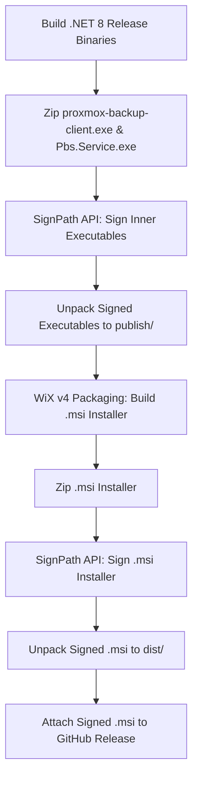

# Code Signing Guide for pbs-client-win

This document outlines the standard operating procedure for Authenticode code signing, certificate acquisition via [SignPath.org](https://signpath.org), binary signing workflow, the strict anti-packing policy, and AV false-positive resolution for `pbs-client-win`.

---

## 1. Overview & Objectives

Code signing for `pbs-client-win` serves three key functions:
1. **Identity & Authenticity**: Proves that the binaries (`proxmox-backup-client.exe`, `Pbs.Service.exe`) and the installer (`.msi`) originated from this open-source project and have not been modified or tampered with.
2. **Windows SmartScreen Trust**: Prevents untrusted executable warnings ("Windows protected your PC") on end-user systems.
3. **Security Posture**: Establishes trusted process identity for enterprise antivirus and EDR solutions.

---

## 2. SignPath.org Free Open Source Certificate Application

[SignPath Foundation](https://signpath.org) provides free Authenticode code signing certificates for qualifying Open Source projects.

### Prerequisites for Application
- **OSI-Approved Open Source License**: `pbs-client-win` is licensed under GNU AGPLv3 (`LICENSE`).
- **Public Code Repository**: Hosted publicly on GitHub.
- **Active Maintenance & Clean Build History**: Automated GitHub Actions CI/CD pipelines.
- **Non-Commercial / Community-Driven**: Independent project (not affiliated with or endorsed by Proxmox Server Solutions GmbH).

### Step-by-Step Application Process

1. **Submit Application**:
   - Navigate to [https://signpath.org/apply](https://signpath.org/apply).
   - Sign in with your GitHub maintainer account.
   - Select the repository `pbs-client-win`.

2. **Provide Project Information**:
   - **Project Name**: `pbs-client-win`
   - **Project Description**: Clean-room .NET 8 implementation of the Proxmox Backup Server client and supervisor service for Windows.
   - **License**: GNU AGPLv3.
   - **Project URL**: `https://github.com/<owner>/pbs-client-win`
   - **CI Pipeline**: GitHub Actions (`.github/workflows/release-signing.yml`).

3. **Configure SignPath Organization & Signing Policy**:
   - Once approved, log into the SignPath Management Console.
   - Create a project named `pbs-client-win`.
   - Create a Signing Policy named `release-signing` associated with the SignPath Open Source Certificate Authority.
   - Authorize GitHub Actions as the sole build integration origin.

4. **Retrieve API Credentials**:
   - Generate an API Token in SignPath with `Signing Request Submitter` permissions.
   - Retrieve your **Organization ID**, **Project Slug** (`pbs-client-win`), and **Signing Policy Slug** (`release-signing`).
   - Add the following secrets to your GitHub repository (**Settings > Secrets and variables > Actions**):
     - `SIGNPATH_API_TOKEN`
     - `SIGNPATH_ORGANIZATION_ID`

---

## 3. Signed Artifacts & Signing Pipeline Sequence

To maintain chain-of-trust integrity, signing MUST follow a strict two-stage sequence:



### Artifact List
1. `proxmox-backup-client.exe` (CLI executable)
2. `Pbs.Service.exe` (Windows Service supervisor executable)
3. `pbs-client-win-<version>-x64.msi` (WiX v4 Windows Installer package)

> [!IMPORTANT]
> **Order Matters**: Inner executables (`proxmox-backup-client.exe` and `Pbs.Service.exe`) MUST be signed **BEFORE** packaging into the MSI. If unsigned executables are bundled inside a signed MSI, real-time protection engines like Microsoft Defender or CrowdStrike will flag the extracted child processes when the service launches them.

---

## 4. Strict Anti-Packing Policy (No UPX / PE Packers)

**Rule: Executable packers (e.g., UPX, ASPack, MPRESS, Themida) are STRICTLY PROHIBITED.**

### Why Packing is Prohibited:
1. **Heuristic Antivirus Flags**: Modern AV/EDR engines evaluate file entropy and unpacker stub signatures. UPX-packed binaries trigger high-entropy heuristic detections (`PE:Unpacker.UPX`, `Heur.Bypass`, `Trojan.Generic`).
2. **Certificate Reputation Damage**: Code signing a packed executable is viewed suspiciously by Microsoft SmartScreen and security vendors. Multiple AV alerts on packed signed binaries will cause CA certificate revocation or reputation reset.
3. **Debugging & Memory Inspection**: Packed binaries obfuscate crash dumps and stack traces, hindering enterprise troubleshooting.

---

## 5. Submitting Antivirus False-Positive Reports

If an AV vendor incorrectly flags signed binaries, follow these procedures to submit a false-positive review request:

### Required Submission Details
- **SHA256 Hash**: Of `proxmox-backup-client.exe`, `Pbs.Service.exe`, and `.msi`.
- **Authenticode Signature Details**: Issuer (`SignPath Foundation`), Serial Number, and Timestamp.
- **Source Link**: `https://github.com/<owner>/pbs-client-win`
- **Build Provenance**: Link to the GitHub Actions run log.

### Vendor Submission Portals

1. **Microsoft Defender Security Intelligence**:
   - Portal: [https://www.microsoft.com/en-us/wdsi/filesubmission](https://www.microsoft.com/en-us/wdsi/filesubmission)
   - Category: Software Developer -> False Positive.
   - Include SHA256 hashes and standard build workflow links.

2. **CrowdStrike Falcon**:
   - Portal: Support Portal / Falcon Console -> Detection Hash Exclusions -> Request Global False Positive Review.
   - Note: Provide process hash and path `C:\Program Files\pbs-client-win\proxmox-backup-client.exe`.

3. **SentinelOne**:
   - Portal: SentinelOne Management Console -> Incidents -> Exclusions -> Report False Positive.

4. **Sophos Intercept X / Sophos Central**:
   - Portal: [https://support.sophos.com/support/s/filesubmission](https://support.sophos.com/support/s/filesubmission)

5. **ESET Endpoint Security**:
   - Email: `samples@eset.com` with subject `False Positive: proxmox-backup-client.exe`.

---

## 6. GitHub Actions CI/CD Signing Job Skeleton

Below is the reference-quality GitHub Actions workflow (`.github/workflows/release-signing.yml`) executing the full build, sign, and release lifecycle:

```yaml
name: Release & Code Signing

on:
  push:
    tags:
      - 'v*'

permissions:
  contents: write
  id-token: write

env:
  DOTNET_CLI_TELEMETRY_OPTOUT: 1
  DOTNET_NOLOGO: 1

jobs:
  build-and-sign:
    name: Build, Sign & Package Release
    runs-on: windows-latest

    steps:
      - name: Checkout repository
        uses: actions/checkout@v4

      - name: Setup .NET SDK 8.0
        uses: actions/setup-dotnet@v4
        with:
          dotnet-version: 8.0.x

      - name: Extract Tag Version
        id: get_version
        shell: pwsh
        run: |
          $tag = "${{ github.ref_name }}"
          $version = $tag.TrimStart('v')
          if ($version -notmatch '^\d+\.\d+\.\d+(\.\d+)?$') {
            $version = "$version.0"
          }
          echo "VERSION=$version" >> $env:GITHUB_ENV

      - name: Publish Binaries
        shell: pwsh
        run: |
          dotnet publish src/Pbs.Cli/Pbs.Cli.csproj -c Release -r win-x64 --self-contained false -o publish/
          dotnet publish src/Pbs.Service/Pbs.Service.csproj -c Release -r win-x64 --self-contained false -o publish/

      - name: Zip Executables for SignPath Signing
        shell: pwsh
        run: |
          Compress-Archive -Path publish/proxmox-backup-client.exe, publish/Pbs.Service.exe -DestinationPath unsigned-binaries.zip

      - name: Sign Executables via SignPath
        uses: signpath/github-action-submit-signing-request@v1
        with:
          api-token: ${{ secrets.SIGNPATH_API_TOKEN }}
          organization-id: ${{ secrets.SIGNPATH_ORGANIZATION_ID }}
          project-slug: 'pbs-client-win'
          signing-policy-slug: 'release-signing'
          artifact-path: 'unsigned-binaries.zip'
          output-artifact-path: 'signed-binaries.zip'
          wait-for-completion: true

      - name: Unpack Signed Executables
        shell: pwsh
        run: |
          Expand-Archive -Path signed-binaries.zip -DestinationPath publish/ -Force

      - name: Install WiX v4 Toolset
        shell: pwsh
        run: |
          dotnet tool install --global wix

      - name: Build WiX MSI Installer
        shell: pwsh
        run: |
          wix build installer/PbsClientWinInstaller.wixproj -p BuildVersion=${{ env.VERSION }} -p PublishDir=..\publish\ -o bin/Release/pbs-client-win-${{ env.VERSION }}-x64.msi

      - name: Zip MSI for SignPath Signing
        shell: pwsh
        run: |
          Compress-Archive -Path bin/Release/pbs-client-win-${{ env.VERSION }}-x64.msi -DestinationPath unsigned-installer.zip

      - name: Sign MSI via SignPath
        uses: signpath/github-action-submit-signing-request@v1
        with:
          api-token: ${{ secrets.SIGNPATH_API_TOKEN }}
          organization-id: ${{ secrets.SIGNPATH_ORGANIZATION_ID }}
          project-slug: 'pbs-client-win'
          signing-policy-slug: 'release-signing'
          artifact-path: 'unsigned-installer.zip'
          output-artifact-path: 'signed-installer.zip'
          wait-for-completion: true

      - name: Unpack Signed MSI
        shell: pwsh
        run: |
          Expand-Archive -Path signed-installer.zip -DestinationPath dist/ -Force

      - name: Create GitHub Release and Attach Signed Installer
        uses: softprops/action-gh-release@v2
        with:
          files: |
            dist/pbs-client-win-${{ env.VERSION }}-x64.msi
          draft: false
          prerelease: false
          generate_release_notes: true
```
